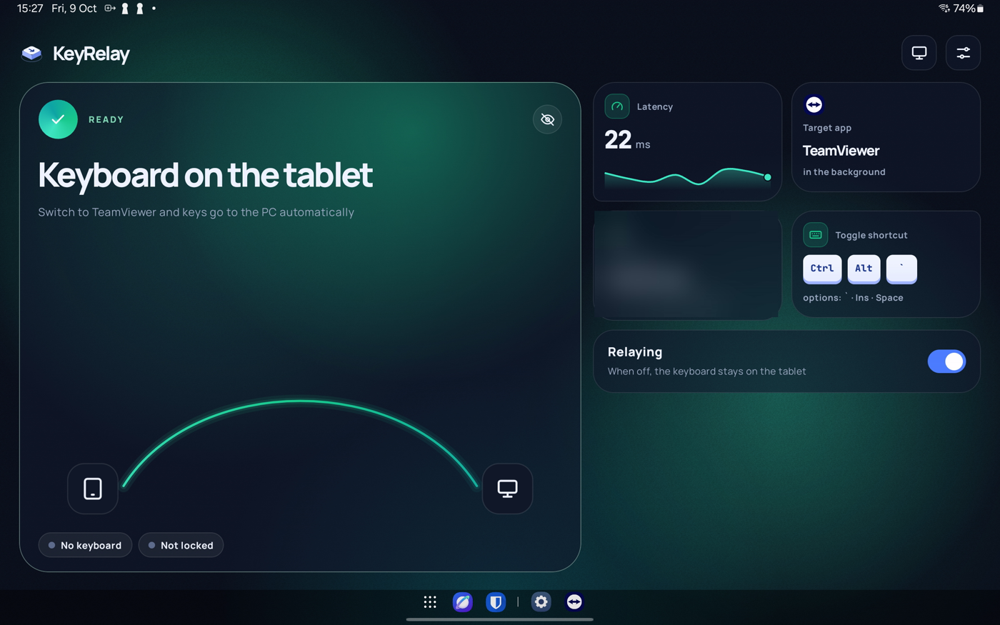
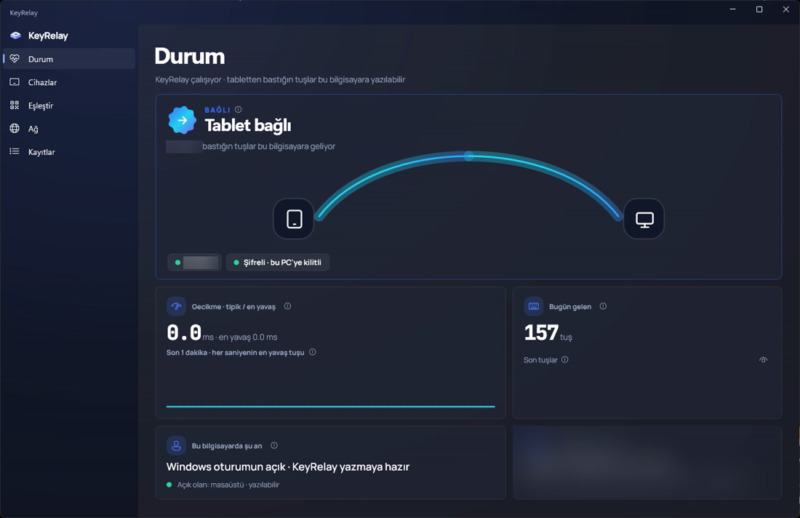
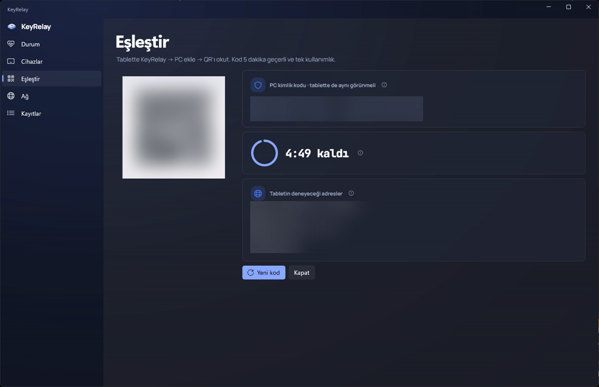
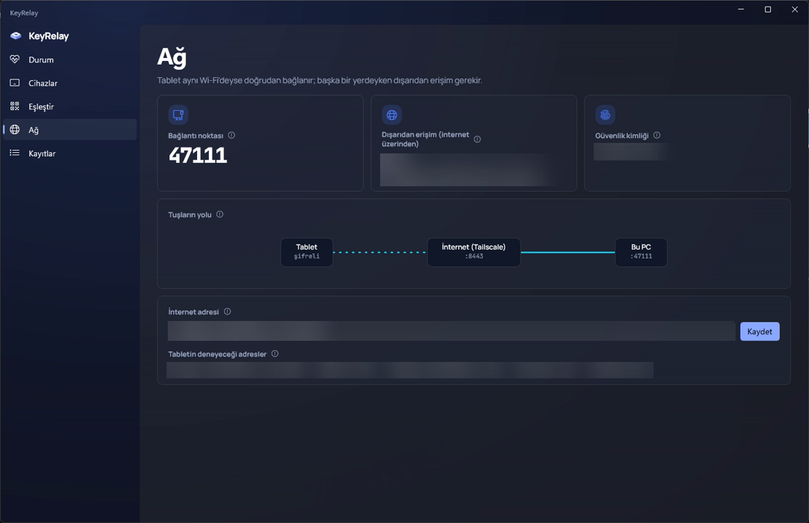
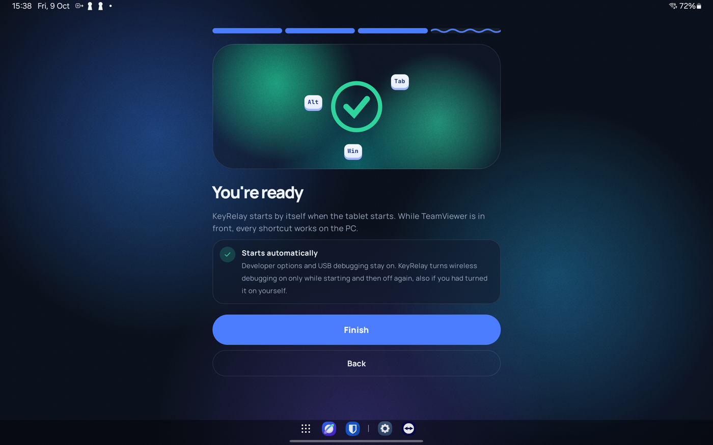
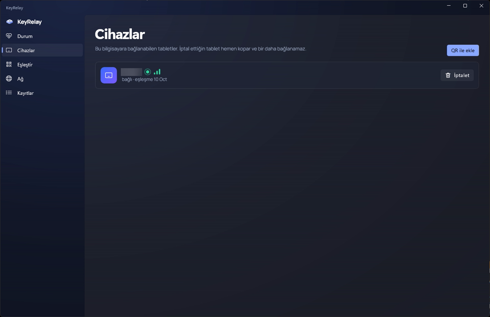

# KeyRelay

Bir Windows bilgisayarı uzaktan yönetirken (örneğin TeamViewer ile) Android tablete bağlı fiziksel klavyeden tüm
Windows kısayollarını kullan: Alt+Tab, Win, Win+E, Ctrl+Alt+Del, kilit ekranında PIN. Aynı Wi-Fi'da da, internet
üzerinden her yerden de, VPN arkasında bile çalışır.

[English](README.md)

<p align="center">
  
  
</p>

## Neden

Android; Alt+Tab, Win (Meta) tuşu ve benzeri kısayolları uygulamalar görmeden yutar. Bu yüzden tabletteki uzak
masaüstü uygulamaları bunları bilgisayara gönderemez. KeyRelay klavyeyi Android'den önce alır ve her tuşu doğrudan
bilgisayara gönderir.

## Nasıl çalışır

- **Tablet:** Android'in kendi kablosuz hata ayıklaması üzerinden başlatılan küçük bir yardımcı (root ya da
  bilgisayar gerekmez), uzak masaüstü uygulaman öndeyken klavyeyi çekirdek seviyesinde okur. Başka bir uygulamadayken
  klavye tablette kalır.
- **Bağlantı:** Tuşlar TLS 1.3 ile yalnız eşleştirdiğin bilgisayara gider; bilgisayarın sertifikası QR kodla sabitlenir.
- **Bilgisayar:** Bir Windows servisi tuşları doğru Windows oturumuna yazar; kilit ekranında, Ctrl+Alt+Del ekranında
  ve UAC pencerelerinde de çalışır. Basılı tutulan tuş tekrar eder; ses ve medya tuşları çalışır.
- **Evden uzaktayken:** [Tailscale Funnel](https://tailscale.com/kb/1223/funnel) bilgisayara bir internet adresi verir
  (ham TCP geçişi; şifreleme uçtan uca kalır). Tablet kafeden ya da ProtonVPN gibi bir VPN arkasından bağlanır.

<p align="center">
  
  
</p>

## Gereksinimler

| | |
|---|---|
| Tablet | Android 11 ya da üstü (denenen: Galaxy Tab S9 Ultra, Android 14), fiziksel klavye (denenen: Logitech MX Keys Mini) |
| Bilgisayar | Windows 11 x64 (Windows 10 denenmedi) |
| Uzaktan yönetim | Herhangi bir uzak masaüstü uygulaması; varsayılan hedef TeamViewer |
| Evden uzaktayken | Bilgisayarda bir [Tailscale](https://tailscale.com) hesabı (ücretsiz plan yeterli) |

## Kurulum

**Bilgisayar**

1. [Releases](../../releases) sayfasından `KeyRelay-Setup-x.y.z.exe` dosyasını indirip çalıştır. Servisi ve tepsi
   uygulamasını kurar, özel ağlar için TCP 47111 portunu açar.
2. İsteğe bağlı, evden uzakta kullanmak için: bilgisayara Tailscale'i kur, yönetici olarak
   `tailscale funnel --bg --tcp 8443 tcp://localhost:47111`
   komutunu çalıştır ve görünen adresi (örneğin `homepc.tailnet-example.ts.net:8443`) **Ağ → İnternet adresi** alanına yaz.

**Tablet**

1. [Releases](../../releases) sayfasından `KeyRelay-x.y.z.apk` dosyasını kur.
2. KeyRelay'i aç; kurulum sihirbazı geliştirici seçeneklerinde, kablosuz hata ayıklama eşleştirmesinde (6 haneli
   kodu doğrudan KeyRelay bildirimine yazarsın) ve bilgisayarını eklemede sana yol gösterir.
3. Bilgisayarda **Eşleştir** sayfasını aç, QR'ı tabletle okut ve PC kimlik kodunun iki ekranda aynı olduğuna bak.

Bundan sonra KeyRelay tablet açılınca kendiliğinden başlar. Uzak masaüstü uygulamana geç ve yaz.

<p align="center">
  
  
</p>

## Bilmekte fayda var

- **Aç/kapat:** Ctrl+Alt+` yönlendirmeyi açıp kapatır (Ayarlar'dan değiştirilebilir).
- **Fn tuşları:** MX Keys Mini gibi klavyelerde üst sıra, Fn kilidine göre F tuşlarını ya da medya tuşlarını gönderir.
- **Gizlilik:** KeyRelay yazdığın tuşları hiçbir yere kaydetmez. "Tuşları göster" (varsayılan kapalı) yalnız son birkaç
  tuşu kendi ekranında gösterir.
- **Güvenlik:** Yalnız kısa ömürlü, tek kullanımlık QR kodla eşleştirdiğin tablet bağlanabilir; bilgisayarda iptal
  ettiğinde bağlantısı hemen kesilir. Eşleştirme ve iptal yalnız bilgisayarda oturum açmış kullanıcıdan yapılabilir.
- **Bilinen sorun:** Tailscale bazen bir Funnel adresinin genel DNS kaydını kaybediyor
  ([tailscale#21502](https://github.com/tailscale/tailscale/issues/21502)). Tailscale yönetim panelinde `funnel` düğüm
  özniteliğini kaldırıp geri eklemek kaydı geri getiriyor.

## Kaynaktan derleme

```powershell
# Windows (.NET 10 SDK, Inno Setup 6)
cd windows; dotnet test KeyRelay.slnx
cd ..; .\installer\build.ps1

# Android (JDK 21)
.\android\gradlew.bat -p android test assembleDebug
```

Protokol: [docs/protocol.md](docs/protocol.md) · Tasarım: [docs/superpowers/specs](docs/superpowers/specs) ·
Ölçümler: [docs/spikes](docs/spikes)

## Lisans

[Apache-2.0](LICENSE)
